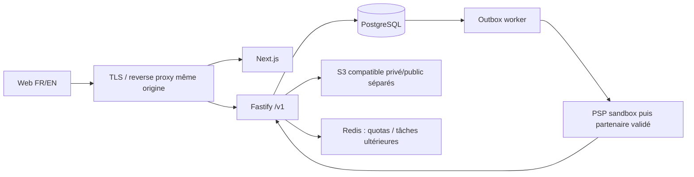

# Architecture cible proposée

## Choix

Monorepo pnpm/Turborepo, monolithe modulaire TypeScript. Next.js App Router/React/Tailwind pour le web ; Fastify et schémas JSON/OpenAPI pour API ; processus worker séparé pour tâches différées. PostgreSQL/Prisma ; Redis pour limitation et BullMQ après besoin concret ; S3 compatible pour médias et pièces privées ; recherche PostgreSQL au départ.
Les processus peuvent évoluer indépendamment sans transformer les domaines en microservices. NestJS écarté au démarrage pour éviter une couche de framework supplémentaire ; Meilisearch et OpenSearch différés faute de volume mesuré.

## Frontières et propriétaires

- Identity : identité externe, session, MFA et rôles plateforme. Le module commerce ne lit jamais les secrets.
- Tenancy : tenant, boutique, membres et vérification. Un tenant peut posséder plusieurs boutiques ; appartenance requise à la boutique, pas seulement au tenant.
- Catalogue/inventaire : publications, variantes et stock par emplacement ; seul propriétaire des réservations.
- Pricing : règles versionnées, prix et commission ; montants exacts et snapshots.
- Checkout/orders : panier → commande parent acheteur → sous-commandes vendeur, orchestration transactionnelle.
- Payments/ledger : adaptateurs PSP, événements, journal et rapprochement ; aucune mise à jour de commande par UI.
- Logistics/after-sales : expédition, preuve, retours et litiges ; transition financière par commande explicite au module payments.
- Groups : seuils et réservations ; ne détient pas de solde financier.
- SaaS/CMS/notifications/admin : habilitations, configuration et supervision ; aucun accès implicite global.

## Isolation multi-tenant

Identité validée côté serveur → appartenance active chargée en DB → contexte tenant/boutique → permission → requête bornée. Ne jamais accepter X-Tenant-Id comme preuve d'autorisation. Catalogue public : projection des publications approuvées, sans accès aux stocks internes, marges ou membres. SellerOrder masque les autres vendeurs ; acheteur accède via userId propriétaire de Order.

Chaque entité privée porte tenantId ; clé étrangère composite (tenantId, parentId), unicité tenant et filtres obligatoires. RLS PostgreSQL en défense supplémentaire : rôle runtime non propriétaire sans BYPASSRLS, SET LOCAL dans transaction, deny-by-default sans contexte. Les politiques RLS, dépôts bornés et tests de lecture sont un lot Phase 1 restant ; les seules FK ne protègent pas les lectures. Plateforme : rôles séparés support/finance/conformité/sécurité, scopes et justification d'accès, audit systématique. Pas de rôle admin omnipotent par défaut.

## Événements et contrats

Transaction DB : mutation métier + audit + outbox. Poller avec FOR UPDATE SKIP LOCKED, bail, retry exponentiel et dead-letter ; livraison au moins une fois, consommateurs idempotents par eventId. Aucun « exactly once » annoncé. BullMQ transporte seulement un identifiant ; DB fait foi. Événements versionnés, envelope eventId/tenantId/aggregateId/type/version/occurredAt/traceId ; minimiser PII. JSON montants sous forme de chaînes et devise obligatoire.
API /v1 proposée, validation stricte additionalProperties:false, erreurs code/message/requestId, pagination curseur, clés d'idempotence bornées à principal/opération/hash de requête. Clé réutilisée avec autre payload → 409.

## État livré

Web de fondations, API liveness/OpenAPI, worker inactif explicite, packages partagés, schéma core et migration initiale. Pas de connexion auth, dépôt catalogue, RLS, queue, stockage S3 ni intégration PSP opérationnels. Voir VALIDATION.md.
