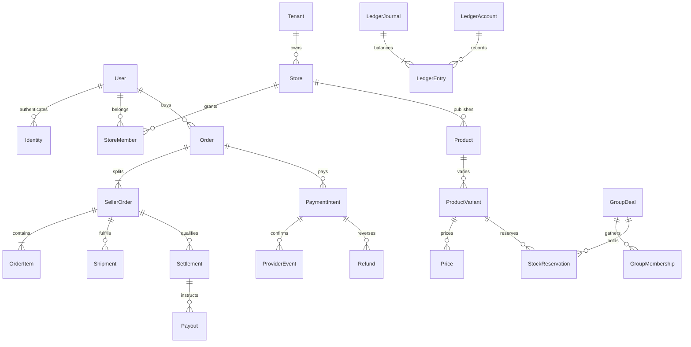

# Modèle de données initial

## Conventions

UUID pour identités métier ; codes ISO pour référentiels ; UTC timestamptz, timezone Africa/Douala dans configuration. BigInt en unités mineures + currency ; XAF 0 décimale, autres devises définies dans Currency. Jamais float ; transport JSON en chaîne. Prix valides sur intervalle [effectiveFrom,effectiveTo), sans chevauchement par portée. Optimistic version et UPDATE conditionnel, transactions pour stock et transitions financières.

## Catalogue logique complet (conception, hors schéma core livré)

- Identité : User(email normalisé unique), Identity(issuer/subject unique), Session(hash unique, expiration/révocation), Role, Permission, RolePermission ; rattachements plateforme à définir avec MFA.
- Tenancy : Tenant(status/version), Store(tenantId, slug unique), StoreMember(tenant/store/user unique), MerchantVerification(status, référence pièces privée, décision/auteur).
- SaaS : SubscriptionPlan(version, quotas), Subscription(tenantId, planVersion, période/état).
- Référentiels : Country, Currency(minorUnits), Locale(direction), TaxRule(pays/portée/version/date).
- Catalogue : Category(parent), Brand, Product(tenant/store/category, statut), ProductVariant(tenant/product, SKU unique par boutique), ProductMedia(référence objet/ordre/alt), Price(variant, montant/devise/palier/dates), Promotion, Coupon(capacité et utilisation atomiques).
- Stock : InventoryLocation(tenant/store), StockMovement(variant/location, delta, cause, idempotencyKey), StockBalance(physique/réservé/version, CHECK 0 ≤ réservé ≤ physique), StockReservation(variant/location/commande ou groupe, quantité, expiry/état). Ces deux dernières entités complètent le cahier pour gérer les invariants.
- Groupes : GroupDeal(variant, seuil, max, début/fin, prix et financeur snapshot), GroupMembership(group/user, quantité/état unique). Réservation et intention de paiement liées explicitement.
- Commerce : Cart(user ou guestTokenHash, devise), CartItem(variant/quantité), Order(buyer/devise/totaux/snapshot), SellerOrder(order/tenant/store), OrderItem(sellerOrder/variant, libellé et prix snapshot). Adresse snapshot distincte du profil.
- Livraison et après-vente : Shipment(sellerOrder, transporteur/statut), DeliveryProof(shipment, référence privée/horodatage), Return(orderItem, quantité/motif/état), Refund(payment/return, montant/état/clé), Dispute(order/payment, preuves/état).
- Paiement : PaymentIntent(order/provider/externalId/état/montant), PaymentTransaction(intent, type/montant/référence unique), ProviderEvent(provider/eventId unique, hash payload, signature/receivedAt/processedAt), Settlement(sellerOrder, éligibilité/règle), Payout(settlement/bénéficiaire/providerId/état).
- Tarification et finance : CommissionRule(version/portée/dates/base/arrondi), CommissionEntry(orderItem/règle snapshot/montant), LedgerAccount(devise/propriétaire/type), LedgerJournal(eventId unique, statut), LedgerEntry(journal/account, débit ou crédit exact), Invoice(numéro séquentiel par entité/période, lignes snapshot, avoir lié). LedgerJournal ajouté pour équilibrage transactionnel par devise ; journal comptabilisé immuable, corrections par contrepassation.
- Relation et contrôle : Notification(user/canal/template/état), Review(orderItem/user unique, modération), AuditLog(actor/action/resource/requestId/date, sans secrets), OutboxEvent(eventId/tenant/aggregate/version/payload/attempts).

## Contraintes et index à appliquer par incrément

Toutes relations privées composites tenantId/parentId ; SKU unique tenant/store, membership unique tenant/store/user ; ProviderEvent unique provider/eventId ; Order index buyer/date ; SellerOrder tenant/statut/date ; Product publication/category et index recherche ; Outbox processedAt/createdAt. Montants et quantités non négatifs avec CHECK, refund cumulé ≤ montant capturé, commissions bornées. Somme débits = crédits par journal/devise garantie lors comptabilisation dans transaction ; déclencheur différé ou fonction DB contrôlée à retenir et tester avant finance.

## ERD cible condensé

## Frontière de la migration livrée

Uniquement User, Identity, Session, Role, Permission, RolePermission, Tenant, Store, StoreMember, MerchantVerification, Country, Currency, Locale, AuditLog, OutboxEvent. Les autres entités restent conceptuelles ; éviter de figer des contrats financiers avant validation. Audit append-only, RLS et politique de rétention restent à implémenter. Les enums StoreRole constituent le RBAC boutique initial ; les tables Role/Permission préparent le RBAC plateforme et ne sont pas encore reliées à une authentification.
