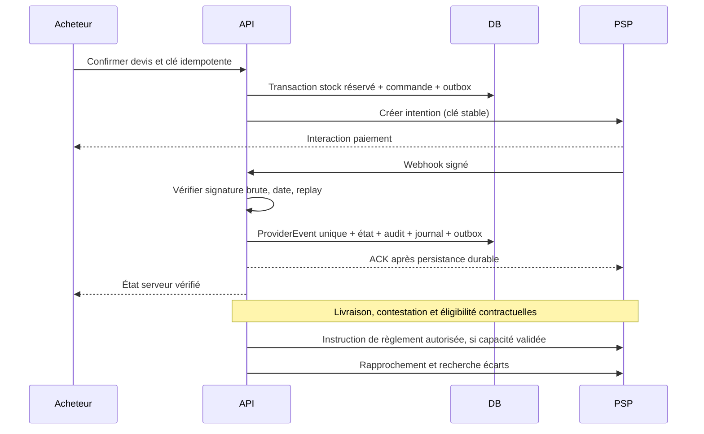

# Paiements et flux financiers

État (Sprint 7) : fondation implémentée — moyens paramétrables par opérateur (ADR 0007), contrat `PaymentProvider` (`packages/payments`), webhook vérifié et idempotent (`apply_payment_event`), adaptateur MOCK de test uniquement. Aucun PSP sélectionné, contrat, agrément, sandbox certifiée ou flux réel. Le journal interne ne constitue ni un séquestre ni une preuve de fonds disponibles. Aucune conservation de fonds présumée légale.

## Contrat PaymentProvider proposé

Capabilities vérifiées par pays/contrat : createIntent, verifyWebhook(rawBody, signature, timestamp), fetchStatus, cancel, refund, reconcile ; authorize/capture, splitSettlement, payout et beneficiaryStatus optionnels. Chaque montant porte devise et unités mineures ; chaque mutation possède clé d'idempotence et référence fournisseur persistée. Une opération non prise en charge renvoie unsupported ; un adaptateur mock doit porter mode=mock et ne peut activer production.

## Séquence de commande

## Traitement robuste

Doublon même eventId → résultat stable sans double écriture. Autre payload pour même id → quarantaine et alerte. Webhook antérieur à réponse initiation → retrouver via référence idempotente, sinon stocker événement orphelin et rapprocher. ACK après vérification/persistance ; retry fournisseur toléré. Payload brut protégé, signature en comparaison constante via SDK fournisseur, fenêtre replay contractuelle, horloge synchronisée. Retour frontend informatif seulement.
Expiration réservation et succès PSP tardif : transaction empêche confirmation sans stock ; politique à valider pour réallocation ou remboursement, alerte obligatoire. Remboursement partiel : total remboursé ≤ capturé, allocation par ligne et inversion proportionnelle des commissions/taxes, frais PSP selon contrat. Chargeback distinct, vendeur suspendu bloque instruction de payout, pas effacement de dette. Livraison non confirmée et litige suspendent éligibilité selon contrat validé.

## Règles de finance

GMV = ventes brutes selon convention à valider ; revenu plateforme ≠ GMV. Séparer taxes, frais PSP, commissions acquises, créances et dettes vendeur. Chaque commande conserve commissionRuleId/version/base/arrondi/date/devise. 5 % standard, 4 % groupé, 5 000/15 000 XAF SaaS sont des hypothèses de simulation, absentes des tarifs actifs.
Journal en partie double équilibré par devise, événement source unique, écritures immuables et contrepassations. Reconnaissance revenu, comptes et numérotation factures à valider avec comptable. Rapprochement quotidien PSP↔transactions↔journal↔règlements ; écarts ouverts, âge et responsable.

## Validations requises avant intégration réelle

Conseil juridique local et partenaire habilité : modèle contractuel marketplace, bénéficiaires, KYC/KYB, conservation éventuelle, règles BEAC/COBAC/CEMAC applicables, délais de contestation, remboursements et reversements. La liste n'est pas un avis juridique ni une conclusion réglementaire. Confirmer MTN/Orange/cartes, XAF, frais et pays via contrats réels. Stratégie DuoDeals (autorisation différée ou encaissement/remboursement) et financeur de remise bloquants avant Phase 4. Sans capacité validée, la fonction reste désactivée.

## Implémentation (Sprint 7)

- **Tentative** : `start_payment`. Elle verrouille la commande ; une même clé donne un rejeu ; une seule tentative en cours ; le moyen doit être actif, dans la bonne devise, dans les plafonds et lié au même adaptateur. Elle prolonge la réservation de 10 minutes.
- **Initiation chez le prestataire** : faite hors transaction. Le résultat est enregistré par `record_payment_initiation` (référence et action suivante, ou échec `provider_error`).
- **Webhook** : signature vérifiée sur le corps brut, puis `apply_payment_event`. Issues possibles : APPLIED, DUPLICATE, QUARANTINED (identifiant réutilisé, référence ou montant différents, échec après succès), ORPHAN, IGNORED.
- **Succès** : commande PAID, réservations CONSUMED, mouvements SALE, contact transmis au vendeur. Si la commande ne peut pas être confirmée (`attentionReason` : order_closed, duplicate_payment, stock_released, amount_mismatch), décision manuelle depuis « Paiements à traiter ».
- **Ajouter un PSP** : écrire un adaptateur `PaymentProvider` (initiate, verifyWebhook) et l'enregistrer dans `providersFromEnv` avec ses secrets d'environnement. Le tester en sandbox réelle avec preuves expurgées, puis créer les moyens correspondants dans l'administration.

## Commissions et journal (Sprint 9)

- **Règles** (`CommissionRule`) : taux en points de base, boutique ou défaut, période de validité. Créées ou closes par le rôle FINANCE seul, jamais rétroactives, historisées dans `ConfigAudit`. **Aucun taux n'est actif par défaut** : les 5 % / 4 % du cahier ne sont pas validés.
- **Photographie au paiement** sur `SellerOrder` : règle, taux, base (articles), commission, net vendeur. Contrôle en base : net = articles + livraison − commission.
- **Écritures** (débit +, crédit −), une par événement source, idempotentes :
  - `order_paid` : PSP_CLEARING + (articles + livraison) ; SELLER_PAYABLE − net (sous-compte du vendeur) ; COMMISSION_DEFERRED − commission ;
  - `commission_earned` (remise prouvée par code) : COMMISSION_DEFERRED + ; COMMISSION_REVENUE − ;
  - `unapplied_payment` (succès non applicable) : PSP_CLEARING + ; REFUND_PAYABLE −.
- **Équilibre** garanti par une contrainte différée à la validation de la transaction. Le runtime n'a aucun droit d'écriture ni de modification : toute correction future passera par contrepassation.
- **Rapprochement** (`finance_report`) : balance par compte, dû par vendeur, et écarts. Écarts signalés : paiement sans écriture, commande payée sans règle, encaissé ≠ comptabilisé par jour (heure de Douala), écriture déséquilibrée. Le relevé du PSP n'est pas encore intégré (pas de PSP réel).

## Fapshi (Sprint 14)

Prestataire retenu pour le Cameroun (MTN Mobile Money, Orange Money, XAF), d'après docs.fapshi.com. Adaptateur `packages/payments/src/fapshi.ts`, testé contre une API simulée ; **à valider en sandbox réelle**.

- **Encaissement** : lien de paiement hébergé (`POST /initiate-pay`, valable 24 h), en-têtes `apiuser`/`apikey`. Notre identifiant de paiement est transmis comme `externalId` et `userId`. Fapshi n'a **aucune idempotence** : un seul appel par tentative locale (`start_payment` garantit une seule tentative en cours). « Direct Pay » n'est pas utilisé : refusé aux plateformes multi-marchands et désactivé par défaut en live.
- **Webhook** : URL unique par service, réglée dans le tableau de bord Fapshi (`https://<site>/v1/payments/webhooks/fapshi`). Authentifié par le secret statique `x-wh-secret` (comparaison à temps constant), qui n'est pas une signature : le corps n'est qu'un déclencheur, le statut fait foi après `GET /payment-status/{transId}`.
- **Rapprochement** : Fapshi n'envoie qu'une notification par événement et ne la renvoie jamais. Le worker relit chaque minute les paiements Fapshi encore en attente depuis 1 à 30 minutes, et une fois tous les 15 passages ceux de moins de 25 h (`pending_provider_payments`, `reconcilePayments`). Un même statut relu deux fois donne le même événement (dédoublonné).
- **Statuts** : SUCCESSFUL → réussi ; FAILED, EXPIRED → échoué (Fapshi ne donne jamais la cause) ; CREATED, PENDING → en attente. Pas de paiement partiel.
- **Frais** : 3 % du montant (champ `revenue`), à intégrer au journal quand le relevé Fapshi sera rapproché.
- **Remboursements et versements vendeurs** : pas d'API de remboursement ; tout passe par `POST /payout` depuis un **service de versement séparé**, alimenté manuellement depuis le service d'encaissement (tableau de bord), 100 à 500 000 XAF par versement, sans idempotence. Désactivé par défaut en live (demande à Fapshi). Non implémenté.
- **Bloquant avant LIVE** : Fapshi indique ne pas accepter les « payment aggregators » (plateformes encaissant pour plusieurs marchands). Accord écrit de Fapshi sur le modèle DuoShop requis, avec validation juridique (détention des fonds pour le compte des vendeurs).
- **Configuration** : `FAPSHI_API_USER`, `FAPSHI_API_KEY`, `FAPSHI_WEBHOOK_SECRET`, `FAPSHI_MODE` (SANDBOX par défaut). Puis créer dans l'administration un moyen de paiement « Mobile Money » lié à l'adaptateur `fapshi`.
