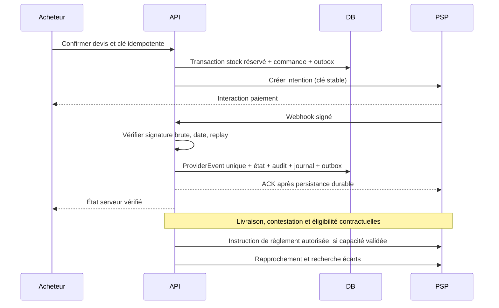

# Paiements et flux financiers

État (Sprint 7) : fondation implémentée — moyens paramétrables par opérateur (ADR 0007), contrat `PaymentProvider` (`packages/payments`), webhook vérifié et idempotent (`apply_payment_event`), adaptateur MOCK de test uniquement. Aucun PSP sélectionné, contrat, agrément, sandbox certifiée ou flux réel. Le journal interne ne constitue ni un séquestre ni une preuve de fonds disponibles. Aucune conservation de fonds présumée légale.

## Contrat PaymentProvider proposé

Capabilities vérifiées par pays/contrat : createIntent, verifyWebhook(rawBody, signature, timestamp), fetchStatus, cancel, refund, reconcile ; authorize/capture, splitSettlement, payout et beneficiaryStatus optionnels. Chaque montant porte devise et unités mineures ; chaque mutation possède clé d'idempotence et référence fournisseur persistée. Une opération non prise en charge renvoie unsupported ; un adaptateur mock doit porter mode=mock et ne peut activer production.

## Séquence de commande

## Traitement robuste

Doublon même eventId → résultat stable sans double écriture. Autre payload pour même id → quarantaine et alerte. Webhook antérieur à réponse initiation → retrouver via référence idempotente, sinon stocker événement orphelin et rapprocher. ACK après vérification/persistance ; retry fournisseur toléré. Payload brut protégé, signature en comparaison constante via SDK fournisseur, fenêtre replay contractuelle, horloge synchronisée. Retour frontend informatif seulement.
Expiration réservation et succès PSP tardif : transaction empêche confirmation sans stock ; politique à valider pour réallocation ou remboursement, alerte obligatoire. Remboursement partiel : total remboursé ≤ capturé, allocation par ligne et inversion proportionnelle des commissions/taxes, frais PSP selon contrat. Chargeback distinct, vendeur suspendu bloque instruction de payout, pas effacement de dette. Livraison non confirmée et litige suspendent éligibilité selon contrat validé.

## Règles de finance

GMV = ventes brutes selon convention à valider ; revenu plateforme ≠ GMV. Séparer taxes, frais PSP, commissions acquises, créances et dettes vendeur. Chaque commande conserve commissionRuleId/version/base/arrondi/date/devise. 5 % standard, 4 % groupé, 5 000/15 000 XAF SaaS sont des hypothèses de simulation, absentes des tarifs actifs.
Journal en partie double équilibré par devise, événement source unique, écritures immuables et contrepassations. Reconnaissance revenu, comptes et numérotation factures à valider avec comptable. Rapprochement quotidien PSP↔transactions↔journal↔règlements ; écarts ouverts, âge et responsable.

## Validations requises avant intégration réelle

Conseil juridique local et partenaire habilité : modèle contractuel marketplace, bénéficiaires, KYC/KYB, conservation éventuelle, règles BEAC/COBAC/CEMAC applicables, délais de contestation, remboursements et reversements. La liste n'est pas un avis juridique ni une conclusion réglementaire. Confirmer MTN/Orange/cartes, XAF, frais et pays via contrats réels. Stratégie DuoDeals (autorisation différée ou encaissement/remboursement) et financeur de remise bloquants avant Phase 4. Sans capacité validée, la fonction reste désactivée.

## Implémentation (Sprint 7)

- **Tentative** : `start_payment`. Elle verrouille la commande ; une même clé donne un rejeu ; une seule tentative en cours ; le moyen doit être actif, dans la bonne devise, dans les plafonds et lié au même adaptateur. Elle prolonge la réservation de 10 minutes.
- **Initiation chez le prestataire** : faite hors transaction. Le résultat est enregistré par `record_payment_initiation` (référence et action suivante, ou échec `provider_error`).
- **Webhook** : signature vérifiée sur le corps brut, puis `apply_payment_event`. Issues possibles : APPLIED, DUPLICATE, QUARANTINED (identifiant réutilisé, référence ou montant différents, échec après succès), ORPHAN, IGNORED.
- **Succès** : commande PAID, réservations CONSUMED, mouvements SALE, contact transmis au vendeur. Si la commande ne peut pas être confirmée (`attentionReason` : order_closed, duplicate_payment, stock_released, amount_mismatch), décision manuelle depuis « Paiements à traiter ».
- **Ajouter un PSP** : écrire un adaptateur `PaymentProvider` (initiate, verifyWebhook) et l'enregistrer dans `providersFromEnv` avec ses secrets d'environnement. Le tester en sandbox réelle avec preuves expurgées, puis créer les moyens correspondants dans l'administration.
